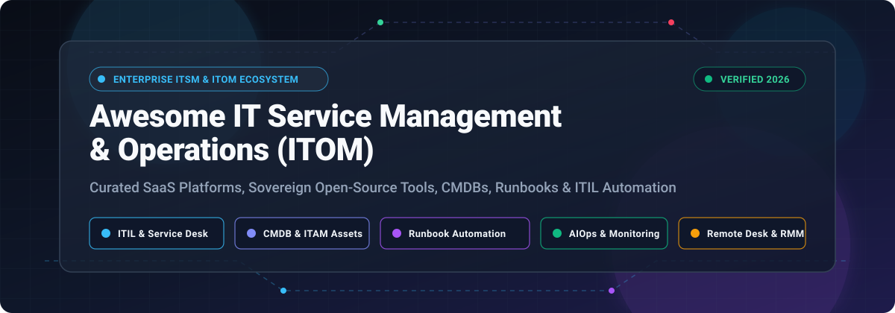

# 🛠️ Awesome IT Service Management (ITSM) & Operations (ITOM)

  

  
  
  
  
  
  
  

---

## 📖 Table of Contents

- [🌐 Sector Overview & Market Dynamics](#-sector-overview--market-dynamics)
- [☁️ SaaS & Hosted ITSM Platforms](#️-saas--hosted-itsm-platforms)
- [💻 Open-Source GitHub Projects](#-open-source-github-projects)
  - [🎫 Service Desk, ITIL Ticketing & Helpdesks](#-service-desk-itil-ticketing--helpdesks)
  - [🗄️ IT Asset Management (ITAM), CMDB & Discovery](#️-it-asset-management-itam-cmdb--discovery)
  - [🤖 Runbook Automation & IT Operations Orchestration](#-runbook-automation--it-operations-orchestration)
  - [📊 Incident Response, AIOps & Observability](#-incident-response-aiops--observability)
  - [🖥️ Remote Desktop, Endpoint Support & RMM](#️-remote-desktop-endpoint-support--rmm)
  - [📚 Knowledge Base, Documentation & Portals](#-knowledge-base-documentation--portals)
  - [🔐 Identity, Single Sign-On & Directory Sync](#-identity-single-sign-on--directory-sync)
- [🤝 How to Contribute](#-how-to-contribute)
- [💖 Support](#-support)
- [📈 Star History](#-star-history)
- [📜 Disclaimer](#-disclaimer)

---

## 🌐 Sector Overview & Market Dynamics

The global Information Technology Service Management (ITSM) and IT Operations Management (ITOM) software market was valued at **$13.5B–$14.3B in 2024–2025** and is projected to surpass **$17.6B by 2026**, expanding at a healthy CAGR of **14% to 16%**. 

The sector displays a **moderately fragmented** competitive dynamic: an oligopoly of enterprise giants (ServiceNow, Atlassian, BMC Software) commands upper-tier Fortune 500 accounts with comprehensive digital workflow and AIOps platforms, while a vibrant ecosystem of mid-market cloud challengers and sovereign open-source projects aggressively captures growing demand for customizable, cost-efficient, and developer-friendly operational tooling.

---

## ☁️ SaaS & Hosted ITSM Platforms

The following table summarizes the market leaders in commercial SaaS ITSM & ITOM, ranked in descending order of corporate scale (market valuation / annual revenue).

| Product | Company Size (Valuation / Revenue) | Pricing | Free Tier / Free Trial Limits | Description |
| :--- | :--- | :--- | :--- | :--- |
| **[ServiceNow ITSM & ITOM](https://servicenow.com)** | **~$105B–$159B Market Cap** ($13.28B Annual Revenue) | Foundation tier starts at **$70–$100 / fulfiller / month** (enterprise volume discounts down to ~$38–$50/agent/mo; annual commitment required) | **Personal Developer Instance (PDI)** free-forever sandbox (1 node, auto-reclaimed after 10 consecutive idle days, no outbound production email, single developer scope) | Market-leading enterprise cloud platform unifying IT service management, service mapping, CMDB, AIOps event management, and automated workflows. |
| **[Jira Service Management (Atlassian)](https://atlassian.com)** | **~$37B–$55B Market Cap** ($5.22B Annual Revenue) | Standard tier starts at **$23.80 / agent / month** (billed monthly) or **$20 / agent / month** (billed annually) | **Free Forever Plan** capped at **3 agents**, unlimited customers, 2 GB file storage, 100 email notifications/day, 500 automation runs/month, and community-only support | High-velocity ITSM and DevOps operations platform connecting incident response, change approvals, and Assets CMDB directly with engineering teams. |
| **[Freshservice (Freshworks)](https://freshworks.com)** | **~$3.3B–$4.8B Market Cap** ($838.8M Annual Revenue) | Starter tier starts at **$19 / agent / month** (billed annually) or **$29 / agent / month** (billed monthly) | **14-day free trial** with full Enterprise feature access, unlimited test tickets, up to 100 asset units, no credit card required | Cloud-native ITSM and IT operations suite offering intuitive ticketing, automated asset discovery, AI virtual agents, and release management. |
| **[SolarWinds Service Desk](https://solarwinds.com)** | **~$3.17B Valuation** ($796.9M Annual Revenue) | Essentials tier starts at **$39 / technician / month** (billed annually) | **30-day free trial** with Premier-level feature access, full automations, visual CMDB maps, no credit card required | Cloud ITSM and IT asset management solution integrating automated network discovery, smart ticket routing, and employee service catalogs. |
| **[BMC Helix ITSM](https://bmc.com)** | **~$2.3B Annual Revenue** (Privately held, KKR-backed) | Base agent licenses start at **~$115 / named user / month** (custom enterprise contract; requester seats included free) | **30-day Proof-of-Concept (POC) / trial sandbox** available via partner/enterprise sales engagement (full ITSM workflow & integration access) | Cognitive enterprise service and operations management platform featuring predictive routing, multi-cloud service brokering, and automated discovery. |
| **[Zoho IT Management (ManageEngine ServiceDesk Plus)](https://manageengine.com)** | **~$1.5B Revenue** (Zoho Corp Division, Bootstrapped) | Standard Cloud tier starts at **$13 / technician / month** (Professional with ITAM at $27/tech/mo, Enterprise with CMDB at $67/tech/mo) | **Free Forever Plan** for up to **5 technicians** (Standard Edition: unlimited requesters, incident tracking, self-service portal, excludes ITAM/CMDB) and **30-day free trial** for Enterprise | Comprehensive IT management and service desk platform integrating ITIL incident/change workflows, CMDB, endpoint management, and network monitoring. |
| **[Ivanti Neurons for ITSM](https://ivanti.com)** | **~$2B Valuation** (~$785M Annual Recurring Revenue) | Base packages start at **~$85 / named analyst / month** or **~$215 / concurrent analyst / month** (annual contract required) | **Custom 14 to 30-day enterprise Proof-of-Concept (POC) sandbox** available via sales consultation (no direct self-service instant trial) | Automated cloud ITSM solution uniting service desk workflows, asset lifecycle tracking, and self-healing endpoint operations. |
| **[TOPdesk](https://topdesk.com)** | **~$1.0B+ Valuation** (~$185M–$200M Annual Revenue; CVC-backed) | Essential tier starts at **$76 (€61 / £51) / operator / month** (unlimited self-service requesters and assets) | **30-day free trial** with full operator & self-service portal functionality, guided onboarding tour, no credit card required | Enterprise service management software providing modular incident, problem, change, CMDB, and operational scheduling portals. |
| **[SysAid](https://sysaid.com)** | **~$150M–$200M Valuation** (~$25M–$37M Annual Revenue; IGP-backed) | Professional AI plan starts at **$89 / agent / month** (annual commitment; includes flat unmetered AI copilot usage) | **14-day free trial** with complete access to AI service desk triage, asset tracking, self-service portal, no credit card required | AI-assisted ITSM and IT operations platform combining automated ticket triage, asset management, patch workflows, and remote control. |
| **[HaloITSM](https://haloitsm.com)** | **~$13M (£10M) Valuation** (~$8M–$10M Annual Revenue, Bootstrapped) | Single all-inclusive tier at **$99 (£69) / agent / month** (billed annually, includes CMDB, ITAM, and AI; unlimited end-users) | **30-day free trial** with full access to all ITIL modules, asset manager, and custom workflow automations, no credit card required | Modern, ITIL-aligned service desk and operations platform delivering customizable workflows, self-service portals, CMDB, and SLA automation. |

---

## 💻 Open-Source GitHub Projects

Explore sovereign, self-hosted alternatives for ITIL service delivery, infrastructure tracking, CMDB modeling, and automated remediation. Repositories in each section are sorted in **descending order by GitHub Stars_Count**.

### 🎫 Service Desk, ITIL Ticketing & Helpdesks

| Project | GitHub_Stars | Focus & Capabilities |
| :--- | :--- | :--- |
| **[Chatwoot](https://github.com/chatwoot/chatwoot)** |  | Modern omnichannel customer and IT support platform connecting email, live chat, Slack, and WhatsApp with team collaboration tools. |
| **[UVdesk Community](https://github.com/uvdesk/community-skeleton)** |  | Open-source PHP/Symfony enterprise service desk and ticketing platform offering mailbox synchronization, knowledge base publishing, and workflow rules. |
| **[GLPI](https://github.com/glpi-project/glpi)** |  | Flagship open-source ITSM and IT Asset Management (ITAM) platform featuring full ITIL helpdesk ticketing, native CMDB, software inventory, and SLA tracking. |
| **[Zammad](https://github.com/zammad/zammad)** |  | Modern, fast open-source helpdesk and IT operations ticketing system with multi-channel intake (email, chat, phone, Slack, Telegram) and Elasticsearch indexing. |
| **[FreeScout](https://github.com/freescout-helpdesk/freescout)** |  | Self-hosted, ultra-lightweight open-source help desk and shared mailbox extensible with SLA, LDAP, knowledge base, and live chat modules. |
| **[osTicket](https://github.com/osTicket/osTicket)** |  | Widely deployed, lightweight open-source support ticketing system seamlessly routing operational requests created via email, web forms, and APIs. |
| **[iTop](https://github.com/Combodo/iTop)** |  | Comprehensive, web-based open-source ITIL ITSM and CMDB solution built by Combodo for managing incidents, changes, known errors, and infrastructure impact analysis. |
| **[Request Tracker (RT)](https://github.com/bestpractical/rt)** |  | Enterprise-grade open-source ticket-tracking system trusted by universities and IT operations teams for granular permissions, custom lifecycles, and email handling. |
| **[Znuny](https://github.com/znuny/Znuny)** |  | Battle-tested open-source enterprise service desk (continuation of OTRS Community Edition) engineered for high-volume IT support queues and SLA workflows. |
| **[OTOBO](https://github.com/RotherOSS/otobo)** |  | Active open-source fork of OTRS featuring a modernized customer portal, Docker-native deployment, ticket automation, and ITSM/CMDB extensions. |

---

### 🗄️ IT Asset Management (ITAM), CMDB & Discovery

| Project | GitHub_Stars | Focus & Capabilities |
| :--- | :--- | :--- |
| **[NetBox](https://github.com/netbox-community/netbox)** |  | Leading open-source source of truth for network infrastructure, IPAM, and Data Center Infrastructure Management (DCIM), widely used as an infrastructure CMDB. |
| **[Snipe-IT](https://github.com/snipe/snipe-it)** |  | Industry-standard open-source IT Asset Management (ITAM) system that pairs with open-source service desks for hardware/license lifecycle and custody tracking. |
| **[Ralph](https://github.com/allegro/ralph)** |  | Full-featured open-source Asset Management, DCIM, and CMDB system engineered by Allegro for tracking data center and back-office hardware lifecycles. |
| **[Nautobot](https://github.com/nautobot/nautobot)** |  | Network Source of Truth and Network Automation Platform acting as an extensible CMDB with programmatic GraphQL APIs and event-driven automation. |
| **[GLPI Agent](https://github.com/glpi-project/glpi-agent)** |  | Cross-platform discovery and inventory agent collecting hardware, software, network SNMP, and hypervisor data for GLPI and open-source ITSM platforms. |
| **[OCS Inventory NG](https://github.com/pluginsGLPI/ocsinventoryng)** |  | Open-source automated hardware and software inventory discovery tool feeding live asset telemetry into GLPI and iTop CMDBs. |

---

### 🤖 Runbook Automation & IT Operations Orchestration

| Project | GitHub_Stars | Focus & Capabilities |
| :--- | :--- | :--- |
| **[Semaphore UI](https://github.com/semaphoreui/semaphore)** |  | Modern open-source web interface for Ansible, Terraform, and OpenTofu allowing IT operations teams to execute approved runbooks and deployments safely. |
| **[StackStorm (st2)](https://github.com/StackStorm/st2)** |  | Event-driven open-source operations automation platform ("IFTTT for Ops") connecting monitoring alerts, ITSM tickets, and auto-remediation workflows. |
| **[Rundeck](https://github.com/rundeck/rundeck)** |  | Open-source runbook automation and operational orchestration platform enabling self-service incident remediation and automated change execution. |

---

### 📊 Incident Response, AIOps & Observability

| Project | GitHub_Stars | Focus & Capabilities |
| :--- | :--- | :--- |
| **[Uptime Kuma](https://github.com/louislam/uptime-kuma)** |  | Fancy self-hosted monitoring tool providing status pages, multi-protocol uptime checks (HTTP, TCP, Ping, DNS), and direct alerting to incident response tools. |
| **[Keep](https://github.com/keephq/keep)** |  | Open-source AIOps and alert management platform bridging infrastructure monitoring alerts with ITSM ticketing, deduplication, and automated workflows. |

---

### 🖥️ Remote Desktop, Endpoint Support & RMM

| Project | GitHub_Stars | Focus & Capabilities |
| :--- | :--- | :--- |
| **[RustDesk](https://github.com/rustdesk/rustdesk)** |  | Open-source, self-hosted remote desktop software enabling IT service desk and operations engineers to securely access and troubleshoot user endpoints. |
| **[Tactical RMM](https://github.com/amidaware/tacticalrmm)** |  | Comprehensive open-source Remote Monitoring & Management (RMM) platform built with Django and Vue, providing automated patching, scripting, and remote terminal access. |

---

### 📚 Knowledge Base, Documentation & Portals

| Project | GitHub_Stars | Focus & Capabilities |
| :--- | :--- | :--- |
| **[Outline](https://github.com/outline/outline)** |  | Fast, collaborative team knowledge base designed for internal IT operations SOPs, runbook guides, and engineering documentation. |
| **[Backstage](https://github.com/backstage/backstage)** |  | Open platform built by Spotify for creating internal developer and self-service portals, unifying service catalogs, docs, and access requests. |
| **[Wiki.js](https://github.com/requarks/wiki)** |  | Modern and extensible open-source wiki software built on Node.js with Markdown, Git storage backend, and enterprise SSO integration. |
| **[BookStack](https://github.com/BookStackApp/BookStack)** |  | Simple, self-hosted platform for storing and organizing IT documentation, disaster recovery SOPs, and service desk knowledge bases. |

---

### 🔐 Identity, Single Sign-On & Directory Sync

| Project | GitHub_Stars | Focus & Capabilities |
| :--- | :--- | :--- |
| **[Keycloak](https://github.com/keycloak/keycloak)** |  | Industry-standard open-source Identity and Access Management (IAM) providing Single Sign-On (SSO), SAML, and OpenID Connect for ITSM platforms. |
| **[Authentik](https://github.com/goauthentik/authentik)** |  | Open-source Identity Provider focused on flexibility and ease of integration into modern cloud-native and Kubernetes self-hosted service desks. |
| **[LLDAP](https://github.com/lldap/lldap)** |  | Lightweight LDAP implementation designed for small to medium setups, easily powering user and group synchronization into GLPI, Zammad, and Nextcloud. |

---

## 🤝 How to Contribute

Contributions are welcome! Please follow these guidelines to keep the list high quality:

1. 🍴 **Fork the repository**.
2. 🌿 **Create a new branch**: `git checkout -b feature/add-new-tool`.
3. 📝 **Add or edit entries in [README.md](file:///C:/Users/ishan/Documents/Projects/Awesome-IT-Service-Management-ITSM-Operations/README.md)**:
   - For **SaaS**: Ensure exact pricing, precise free-tier/trial limits, company size metrics, and official website links are provided.
   - For **Open-Source**: Include the repository link, Stars_Badge (`style=social&color=white` linking to the stargazers page), and maintain descending star order within each category.
4. 🚀 **Submit a Pull Request** with a concise description of the tool and why it adds value to the ITSM/ITOM ecosystem.

---

## 💖 Support

If you find this curated collection of ITSM & ITOM resources helpful, please consider supporting the project:

- ⭐ **Star this repository** on GitHub to increase its visibility for fellow DevOps and IT operations engineers!
- 🍴 **Fork the repo** to keep a personal reference and share your improvements back with the community.
- 📢 **Share this list** with your colleagues, teams, and social networks.
- ☕ **Buy me a coffee**: If you'd like to support ongoing maintenance and new additions, consider sponsoring via the [GitHub Sponsors Dashboard](https://github.com/sponsors/ishandutta2007). Your support is greatly appreciated!

---

## 📈 Star History

---

## 📜 Disclaimer

This repository is a **community-curated index** created for educational, research, and technical evaluation purposes. All product names, logos, trademarks, and registered trademarks are property of their respective owners. Inclusion in this repository does not imply formal endorsement.
